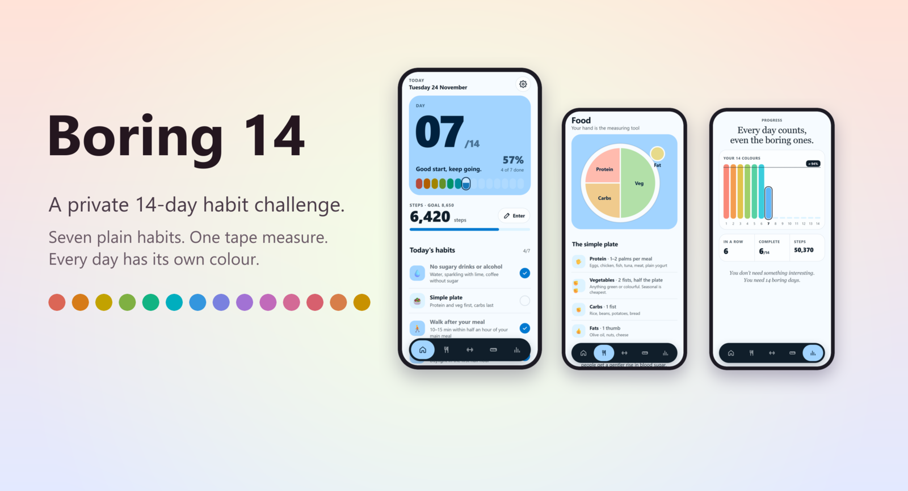
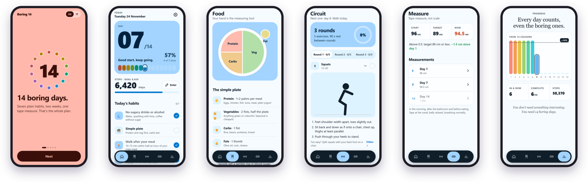

<p align="center">
  
</p>

<p align="center">
  <b>A private 14-day habit challenge for your phone.</b><br>
  Seven plain habits, one tape measure, and a new colour every day.
</p>

<p align="center">
  <a href="https://muteki-met.github.io/boring14/"><b>Open the app</b></a> ·
  <a href="https://muteki-met.github.io/boring14/#demo"><b>Try the demo</b></a> ·
  English · Italiano
</p>

---

## Why "boring"?

Most challenges die on day five because they're exciting and exhausting. Boring 14 does the opposite: small, repeatable habits that are almost too simple to skip. You track your **waist**, not your weight, because the tape measure tells you more than the scale.

## The seven habits

| | Habit | What it means |
|---|---|---|
| 💧 | **No sugary drinks or alcohol** | Water by default, sparkling with lime, coffee without sugar |
| 🥗 | **Simple plate** | Protein and veg first, carbs last, portions measured with your hand |
| 🚶 | **Walk after your meal** | 10–15 minutes within half an hour of your main meal |
| 👟 | **More steps** | Count for two days, then +2,000, rising to 8–10k |
| 💪 | **Bodyweight circuit** | 3 rounds, about 20 minutes, on days 3, 5, 8, 10 and 12 |
| ⏰ | **Same wake-up time** | Daylight in the first half hour, no caffeine after early afternoon |
| 🌙 | **Kitchen closed after dinner** | Hungry? Water, wait 15 minutes, then yogurt or an egg |

Waist measurements happen on **days 1, 7 and 14**. The goal: a waist under half your height.

## Screens

<p align="center">
  
</p>

## What's inside

- **Today**: a huge day number in that day's colour, your progress and a 14-day journey bar. Tap a past day to fill it in.
- **A colour for every day**: 14 hand-picked pastel tones, from coral on day 1 to gold at the finish line.
- **Animated welcome tour** that also shows you how to add the app to your Home Screen.
- **Pick your start date**: today, tomorrow or any day, with a countdown and a "get ready" list.
- **Food guide**: the simple plate, hand portions (palm, fist, thumb), a rotating menu and practical tips.
- **Circuit**: animated figures for every exercise, step-by-step instructions, a round tracker and a 90-second rest timer.
- **Measure**: waist on days 1, 7 and 14 with the waist-to-height ratio.
- **Progress**: your 14 colours as a chart, your streak, completed days and total steps.
- **Confetti** when a day is complete. Obviously.
- **English and Italian**, picked automatically from your phone and changeable in Settings.

## Install it on your phone

It's a web app: no App Store, no account.

**iPhone (Safari)**
1. Open [muteki-met.github.io/boring14](https://muteki-met.github.io/boring14/) in **Safari**
2. Tap **Share**, then **Add to Home Screen**
3. Open it from the Home Screen: it runs full screen and works offline

**Android (Chrome)**
1. Open the link in **Chrome**
2. Tap **Install app** (or the ⋮ menu, then **Add to Home screen**)

## Apple Watch steps

A web app can't read Apple Health directly, so Boring 14 uses a tiny **iOS Shortcut**: it reads today's steps from Health, copies the number, and you tap **Sync** in the app. The same Shortcuts app can send you daily reminders (walk after lunch, kitchen closed). The full guide is inside the app under **Settings → Apple Watch and reminders**.

On Android, enter your steps by hand.

## Privacy

- No account, no server, no analytics, no tracking.
- Everything you log stays in your phone's browser storage.
- The only outside link is the optional "Video" search on YouTube, and only if you tap it.

## Run it locally

No build step and no dependencies:

```bash
python -m http.server 8414
# then open http://localhost:8414
```

Open `http://localhost:8414/#demo` for sample data. Demo data lives only in memory and is never saved.

Run the logic self-check:

```bash
node test.mjs
```

## Project structure

| File | What it does |
|---|---|
| `index.html` | Page shell and all styles |
| `app.js` | Screens, tour, interactions, storage |
| `challenge.js` | Challenge rules: day count, step targets, schedule, day colours |
| `i18n.js` | English and Italian texts (add a language by copying the `en` block) |
| `figures.js` | Animated exercise figures (SVG) |
| `sw.js` | Offline support |
| `test.mjs` | Self-check for the challenge logic and translations |
| `docs/` | README images (`make_hero.py` rebuilds the cover) |

## Health note

Boring 14 is a habit tracker, not medical advice. If you have diabetes, high blood pressure, take medication, are pregnant or have any health condition, talk to your doctor before changing your diet or activity. Results vary from person to person.

---

<p align="center"><i>You don't need something interesting. You need 14 boring days.</i></p>
